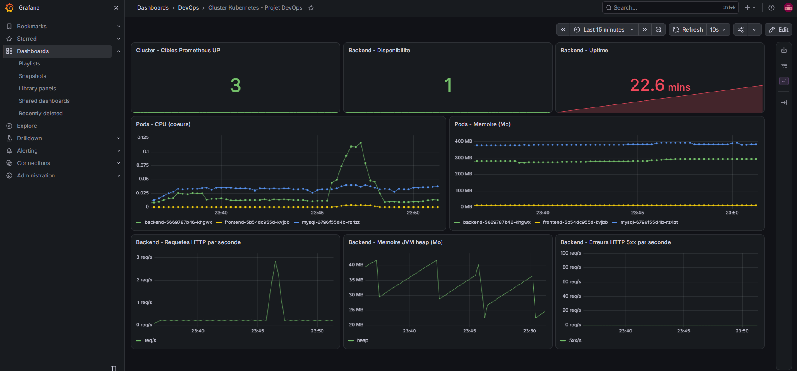

# Déploiement Kubernetes (Minikube) du projet fil rouge

Déploiement de l'application Spring Boot, Angular et MySQL dans un cluster Minikube. Les images sont récupérées sur Docker Hub (`ezer2002/gestion-projets-backend` et `ezer2002/gestion-projets-frontend`).

## Architecture

    Navigateur --> Service frontend (NodePort 30080) --> Pod frontend (nginx)
                                                              | /api/*  (proxy_pass http://backend:8080/)
                                                              v
                                            Service backend (ClusterIP 8080) --> Pod backend (Spring Boot)
                                                                                      | jdbc:mysql://db:3306
                                                                                      v
                                                    Service db (ClusterIP 3306) --> Pod mysql --> PVC mysql-pvc (1 Gi)

Tout vit dans l'espace de noms `gestion-projets`.

## Fichiers

| Fichier | Contenu |
|---|---|
| `k8s/00-namespace.yaml` | Espace de noms `gestion-projets` |
| `k8s/mysql.yaml` | PersistentVolumeClaim, Deployment MySQL 8.0 et Service `db` |
| `k8s/backend.yaml` | Deployment Spring Boot et Service `backend` |
| `k8s/frontend.yaml` | Deployment Angular/nginx et Service `frontend` (NodePort 30080) |

## Choix de conception

- Les Services s'appellent `db` et `backend`, comme dans Docker Compose : le `nginx.conf` du frontend (`proxy_pass http://backend:8080/`) fonctionne donc sans modification.
- Les identifiants MySQL ne sont pas dans les manifestes : ils viennent d'un **Secret** `mysql-secret`, créé dans le cluster à partir du fichier `.env` local (jamais versionné).
- Un `initContainer` fait attendre le backend tant que MySQL ne répond pas sur le port 3306.
- Sondes de santé : `readinessProbe` et `livenessProbe` du backend sur `/actuator/health`. Sonde de MySQL : `mysqladmin ping`.
- Le backend porte les annotations `prometheus.io/*` pour la supervision.

## Déploiement manuel

    export KUBECONFIG=~/.kube/minikube.yaml
    minikube start
    kubectl create namespace gestion-projets
    kubectl create secret generic mysql-secret -n gestion-projets --from-env-file=../04-fullstack-app-pipeline/.env
    kubectl apply -f k8s/
    kubectl rollout status deployment/backend -n gestion-projets --timeout=420s
    kubectl get pods,svc -n gestion-projets

## Accès et tests

Depuis la VM, par le NodePort de Minikube :

    curl http://192.168.49.2:30080/
    curl http://192.168.49.2:30080/api/entreprise/all

Depuis un navigateur extérieur à la VM (port-forward sur le port 8085) :

    kubectl port-forward --address 0.0.0.0 -n gestion-projets svc/frontend 8085:80

Puis ouvrir `http://IP_VM:8085`.

## Suite

Étape de déploiement automatique dans le Jenkinsfile, puis Prometheus et Grafana dans le cluster.

## Déploiement automatisé par Jenkins

L'étape `Deploy Minikube` du Jenkinsfile applique les manifestes du dossier `k8s/` en remplaçant le tag `latest` par le numéro de build, puis attend la fin du déploiement (`kubectl rollout status`). Chaque build produit donc des images versionnées, et le cluster ne tourne que sur une version identifiée.

## Supervision dans le cluster

Le dossier `monitoring/` déploie Prometheus et Grafana dans le namespace `monitoring`.

- Prometheus découvre les pods à superviser grâce aux annotations `prometheus.io/scrape`, `prometheus.io/path` et `prometheus.io/port`. Le backend expose ses métriques sur `/actuator/prometheus`.
- cAdvisor, intégré au kubelet, fournit le CPU et la mémoire de chaque pod.
- Grafana démarre avec la datasource et le dashboard déjà configurés (provisioning par ConfigMap), sans manipulation manuelle.

Déploiement :

    kubectl apply -f monitoring/prometheus.yaml
    kubectl create configmap grafana-dashboards -n monitoring --from-file=monitoring/dashboards/cluster-devops.json --dry-run=client -o yaml | kubectl apply -f -
    kubectl apply -f monitoring/grafana.yaml

Accès local avec `kubectl port-forward -n monitoring svc/grafana 3001:3000` (compte `admin`, mot de passe à changer).

